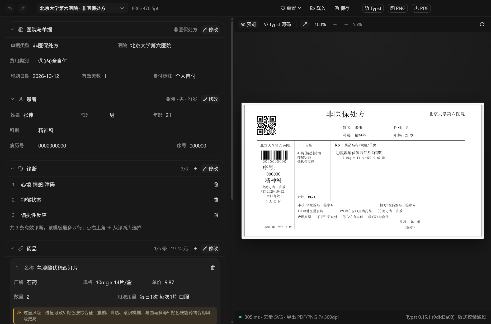
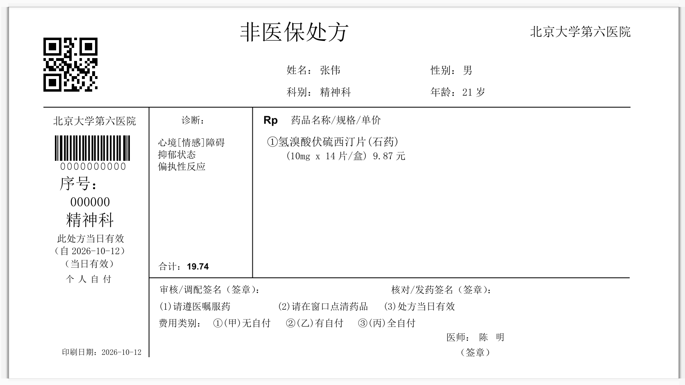
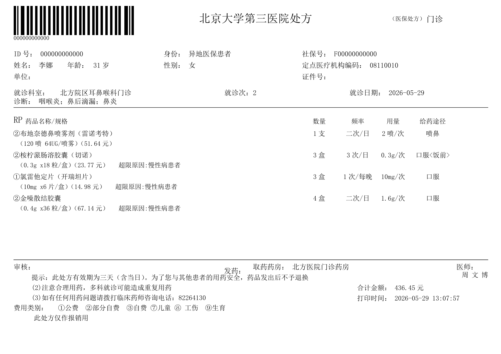
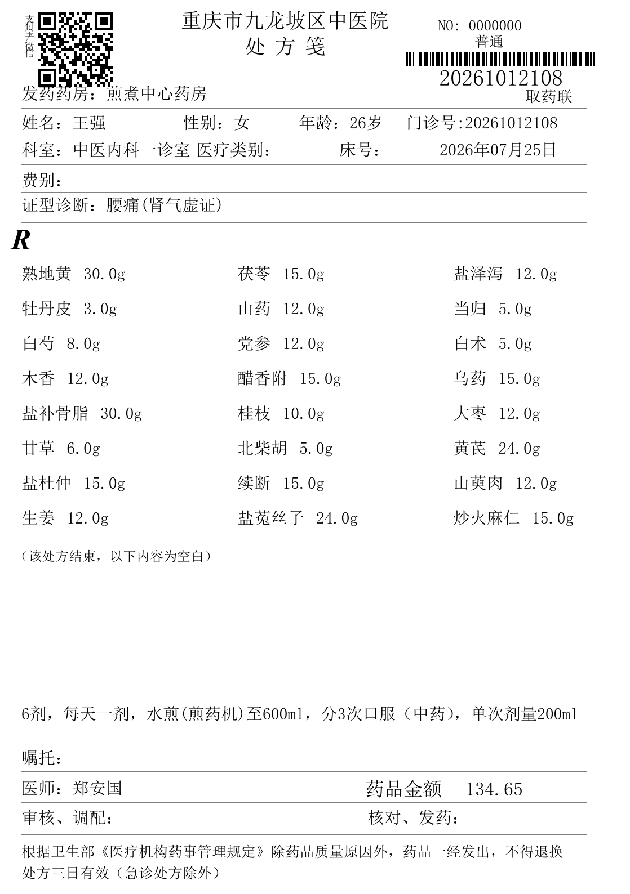

# Prescription Master

[](LICENSE)
[](https://www.electronjs.org/)
[](https://react.dev/)
[](https://www.typescriptlang.org/)
[](https://typst.app/)
[](https://github.com/XXXXXQ-0206/prescription/actions/workflows/ci.yml)
[](https://github.com/XXXXXQ-0206/prescription/actions/workflows/codeql.yml)
[](CONTRIBUTING.md)

> A desktop application that generates hospital prescription sheets from a form, lays them out with
> **Typst**, and exports **PDF / PNG (300 dpi) / Typst source** with pixel-accurate previews.

---

## Project Overview

Prescription Master is an Electron desktop application for producing prescription sheets that match the
paper layouts used by several hospitals. The user fills in a form (hospital, patient, diagnosis, drugs,
prescription options); the application converts that data into a Typst document, compiles it with a
bundled Typst engine, and renders the result as a vector SVG preview plus PDF / PNG exports.

The repository contains two deliverables:

| # | Deliverable | Location | Description |
| - | ----------- | -------- | ----------- |
| 1 | Typst replica of a scanned prescription | [`prescription.typ`](prescription.typ), [`prescription_scan_like.typ`](prescription_scan_like.typ) | A scanned sheet was measured pixel by pixel and re-typeset as vector Typst at 1 px = 0.5 pt. |
| 2 | **Prescription Master** desktop app | [`studio/`](studio/) | Multi-template prescription generator with live preview and PDF/PNG/Typst export. |

The scanned source sheets and every development artefact derived from them are **deliberately not
distributed** (see [Privacy and data](#privacy-and-data)). All sample data shipped in the source code is
fictional and intended for demonstration only.

---

## Features

### Multi-template layout engine

Five hospital layouts are implemented in [`studio/src/templates/`](studio/src/templates/), each with its own
geometry, field set, section flags and content limits. Switching a template applies its own example data and
extended fields.

| Template ID | Layout | Page (pt) | Limits (diagnoses / drugs) |
| ----------- | ------ | --------- | -------------------------- |
| `bj6` | Peking University Sixth Hospital — non-insurance prescription; four-cell table with a closed paper-edge shadow frame (absolute positioning) | 836 × 470.5 | 8 / 5 |
| `zz` | Zhengzhou Central Hospital prescription sheet; QR code, "ordinary / valid today" box, two-line Rp drug rows | 419.5 × 595.3 | 12 / 20 |
| `bj3` | Peking University Third Hospital (insurance) outpatient prescription; landscape, barcode + ID / identity / social-security fields, five-column drug table | 842 × 595.3 | 6 / 6 |
| `zy` | Fifth Affiliated (Zhuhai) Hospital of Zunyi Medical University; barcode, bilingual hospital name, two lines per drug | 419.5 × 595.3 | 6 / 6 |
| `cq` | Chongqing Jiulongpo District TCM Hospital; three-column herb grid, decoction instructions, pharmacy-regulation footer | 559 × 794 | 8 / 60 |

### Preset libraries

Everything is editable — the presets are starting points, not a controlled vocabulary.

| Preset | Content |
| ------ | ------- |
| Hospitals | 40 |
| Departments | 22 |
| Diagnoses | 11 categories, 105 entries |
| Drugs | 77 psychiatric / general medicines with brand, specification, unit price, usage and **overdose (OD) risk notes** |
| Regimens | 68 ready-made "diagnosis + medication" combinations |
| Usage presets | 25 |
| Tip sets | 7 |
| Doctors | 8 (freely replaceable) |

### Rendering and export

- **Form data → Typst source → vector SVG preview / PDF / PNG**, so the preview and the export are byte-identical.
- PNG export at **300 dpi**; PDF is vector; the generated `.typ` file can be version-controlled or recompiled by hand.
- Preview is a real SVG: zoom 20 %–250 %, sharp at any scale.
- Prescription data can be saved to / loaded from JSON; the current draft is restored on the next launch.
- **Code 128** barcode generated from the record number (automatically uses code set C for even-length digits,
  which produces wider, easier-to-scan bars) and an in-house QR encoder — no runtime barcode/QR dependency.

### Desktop integration

- Fixed 1240 × 820 window with a native title-bar overlay.
- **System tray**: closing the window hides it; the tray menu shows/hides the window and really quits.
- **Single instance**: launching a second copy focuses the running window instead of opening a new one.
- Save dialogs for PDF / PNG / Typst / JSON, plus "reveal in folder" after export.
- Hardened renderer: `contextIsolation: true`, `nodeIntegration: false`, `contextBridge` preload only, and a
  restrictive Content-Security-Policy in [`studio/index.html`](studio/index.html).
- Keyboard shortcuts: `Ctrl+S` save data, `Ctrl+E` export PDF, `Ctrl+P` export PNG.

### Performance

1. **Render cache** — identical Typst source is compiled once (LRU of 24 entries); undo or flipping between
   two field values costs nothing.
2. **Request coalescing** — only one preview compilation runs at a time; a newer request kills the in-flight
   process, so continuous typing never queues (measured 250–550 ms per compile).
3. **Warm-up** — a minimal document is compiled before the window appears (`TYPST_PREWARM ok`), so the first
   paint drops from ≈1.9 s cold to ≈0.3 s.
4. **Stale response rejection** — every request is numbered; late results never overwrite a newer preview.

### Safety and validation aids

- **Overdose (OD) risk hints** for the drugs in the preset library, shown in the UI only. The templates never
  read that field, so it is **never printed on a prescription**.
- Layout validation: diagnoses over the template limit, drugs over the limit, missing patient name, over-long
  names or specifications — reported under the preview (red = not printed, orange = warning).
- Amount totals are computed live as price × quantity.

---

## Screenshots



*Form on the left, live vector preview on the right, export buttons in the top bar.*

| Template `bj6` (replica) | Template `bj3` (insurance, landscape) | Template `cq` (traditional Chinese medicine) |
| --- | --- | --- |
|  |  |  |

> All screenshots were produced with the built-in fictional demo data.

---

## Demo Data

Everything published in this repository is **fictional demonstration data**:

- **All patient and physician names, medical-record numbers, barcode numbers, prescription numbers and ID
  numbers are invented.** They follow the format and length of the real documents the layouts were measured
  from, so that the columns stay aligned, but they belong to nobody.
- **Hospital names, and the public switchboard / clinical-pharmacist phone numbers** printed on the sheets, are
  reproduced **for illustration only**, to identify which paper form a template recreates. They imply no
  affiliation with, endorsement by, or cooperation with those institutions.
- **The sample prescriptions exist to demonstrate the layout engine.** The screenshots, `prescription.typ`,
  `prescription_scan_like.typ`, every per-template example document and the preset libraries (drug names,
  specifications, prices, dosages, overdose-risk notes) are demo values; they may be incomplete or outdated and
  must never be relied on clinically — see the [Disclaimer](#disclaimer).

---

## Installation

### Prerequisites

| Requirement | Notes |
| ----------- | ----- |
| **Windows 10/11 (x64)** | The layouts depend on fonts that ship with Windows: **SimSun (宋体)**, Arial, Courier New. |
| **Node.js ≥ 20** | Node 22 is used for development. |
| **Typst 0.15.x** | Not vendored in this repository (see below). |

### 1. Clone

```bash
git clone https://github.com/XXXXXQ-0206/prescription.git
cd prescription
```

### 2. Get the Typst runtime

```bash
cd studio
npm run fetch:typst      # downloads Typst 0.15.1 and unpacks resources/typst.exe
```

Manual alternatives and the proxy notes are in [Getting the Typst Runtime](#getting-the-typst-runtime).

### 3. Install dependencies and start

```bash
cd studio
npm install
npm start          # builds the renderer and launches the desktop app
```

---

## Getting the Typst Runtime

The templates are compiled by the [Typst](https://typst.app/) CLI, which is **not vendored** in this repository
(a 50 MB third-party binary, ignored by Git). One command fetches the pinned version:

```bash
cd studio
npm run fetch:typst              # Typst 0.15.1 → studio/resources/typst.exe
npm run fetch:typst -- --force   # re-download even if a binary is already there
npm run fetch:typst -- --proxy http://127.0.0.1:7897   # explicit proxy
npm run fetch:typst -- --no-proxy                      # ignore the environment
```

The script is idempotent: when `resources/typst.exe` already reports `typst 0.15.1 (…)` it exits immediately
without touching the network. It downloads the official `typst-x86_64-pc-windows-msvc.zip` asset of the pinned
[Typst release](https://github.com/typst/typst/releases/tag/v0.15.1), checks it against the **byte size and
SHA-256 fingerprint pinned in the script** (Typst publishes no `.sha256` sidecar), unpacks `typst.exe` from it
in pure JavaScript and re-runs `typst --version` to confirm the result. Proxies are resolved as
`--proxy <url>` → `HTTPS_PROXY` / `HTTP_PROXY` (with `NO_PROXY` bypasses), and `--no-proxy` forces a direct
connection; `TYPST_URL` can point at a mirror or an intranet copy.

Without a network connection, either:

- download `typst-x86_64-pc-windows-msvc.zip` from the
  [Typst releases page](https://github.com/typst/typst/releases) and copy the `typst.exe` inside it to
  `studio/resources/typst.exe`, or
- download the plain `typst-0.15.1-windows-x64.exe` attached to
  [this project's v1.0.0 release](https://github.com/XXXXXQ-0206/prescription/releases/tag/v1.0.0) and
  save it as `studio/resources/typst.exe`.

Verify with `studio/resources/typst.exe --version` — it must print `typst 0.15.1`. In development the
application reads `resources/typst.exe`; in a packaged build it reads `typst.exe` from the application
resources directory (`extraResources`).

---

## Usage

1. **Pick a template** in the top bar (`单据模板`). The template switch loads its own example data and fields.
2. **Fill in the left form** — document type and hospital, patient, diagnoses, drugs, doctor and layout options.
   Field groups collapse; every change updates the preview immediately (200 ms debounce).
3. **Check the preview** on the right. Zoom with the toolbar or `Ctrl` + mouse wheel; the status bar shows the
   render time, cache hits, the Typst version and the layout-validation result.
4. **Export** with the `Typst` / `PNG` / `PDF` buttons (or `Ctrl+E` / `Ctrl+P`).
5. **Save or load** the prescription as JSON, or just close the window — the draft is restored next time.

### Command line entry points

| Command (from `studio/`) | Purpose |
| ------------------------- | ------- |
| `npm start` | Build the renderer and launch the desktop app |
| `npm run dev` | Launch against the Vite dev server (hot reload of the UI) |
| `npm run build` | Build the renderer into `dist/` only |
| `npm run shot` | Launch, capture a screenshot to `shot.png`, exit (unattended self-check) |
| `node scripts/start.mjs --export-test` | Compile `out/generated.typ` to PDF/PNG/SVG without a window |
| `node scripts/render-all.mjs` | Render every template with its default data to `out/tpl-<id>.png` |
| `node scripts/test-variants.mjs` | Compile all layout variants |
| `node scripts/check-presets.mjs` | Assert the consistency of the preset libraries |
| `node scripts/check-odrisk.mjs` | Assert the overdose-risk table (coverage, scope, duplicates) |
| `node scripts/check-tcm.mjs` | Assert the traditional-medicine herb library |
| `npm run bundle` | Bundle every `scripts/*.ts` entry point into `scripts/<name>.mjs` |
| `npm run fetch:typst` | Download the pinned Typst runtime into `resources/` |
| `npm test` | Bundle, then run the full local self-check suite (variants, extremes, generators, checks) |

> **Note**: a `scripts/<name>.mjs` that has a same-named `.ts` source is a **build product** (bundled with
> [rolldown](https://rolldown.rs/)), not a source file, and it is not committed. Run `npm run bundle` once
> after cloning — and after editing any `scripts/*.ts` — before invoking those entry points.
> `npm run bundle -- <name>` rebuilds a single entry point, and `npm run bundle -- --check` only verifies
> that the products exist and are up to date.

---

## Build Instructions

```bash
cd studio

# 0. Fetch the Typst runtime (once per clone)
npm run fetch:typst

# 1. Type-check (no emit)
npx tsc --noEmit

# 2. Bundle the dev entry points (scripts/*.ts → scripts/*.mjs)
npm run bundle

# 3. Build the renderer
npm run build                 # → studio/dist

# 4. Package the desktop application
npm run pack                  # → studio/release/PrescriptionMaster/
```

`npm run pack` calls `scripts/pack.mjs`, a dependency-free packager that copies the Electron runtime plus the
application files into a **self-contained, relocatable folder** (`studio/release/PrescriptionMaster/`, ignored
by Git), generates the launchers and smoke-tests the result. An NSIS installer / portable `.exe` can
additionally be produced with `npx electron-builder --win`, which uses the `build` block in
`studio/package.json` and picks up `resources/typst.exe` through `extraResources`. Both paths require
`studio/resources/typst.exe` to exist.

Packaging details, a portable-build smoke test and troubleshooting notes live in
[`docs/PACKAGING.md`](docs/PACKAGING.md); template authoring is documented in
[`docs/TEMPLATES.md`](docs/TEMPLATES.md) and the preset libraries in [`docs/PRESETS.md`](docs/PRESETS.md).

These are exactly the steps CI runs on every push to `main` and on every pull request — see
[`.github/workflows/ci.yml`](.github/workflows/ci.yml).

---

## Project Structure

```
prescription/
├── README.md                     # this file
├── LICENSE                       # MIT
├── CONTRIBUTING.md  SECURITY.md  CODE_OF_CONDUCT.md  CHANGELOG.md
├── .github/                      # CI + CodeQL workflows, Dependabot, issue & PR templates
├── docs/
│   ├── PACKAGING.md              # English reference: packaging and distribution
│   ├── TEMPLATES.md              # English reference: template system
│   ├── PRESETS.md                # English reference: preset libraries
│   ├── zh-CN/                    # Chinese originals of the three references
│   └── images/                   # screenshots used by the README
├── prescription.typ              # vector Typst replica (clean electronic version)
├── prescription_scan_like.typ    # replica tuned to match the scan (paper noise, blur)
└── studio/
    ├── electron/
    │   ├── main.mjs              # main process: window, tray, IPC, Typst compile/export, JSON I/O
    │   └── preload.cjs           # contextBridge surface (`window.presc`)
    ├── src/
    │   ├── App.tsx               # shell: top bar + form + preview, state and export orchestration
    │   ├── components/           # FormPanel / PreviewPanel / Picker / bits
    │   ├── templates/            # template system: types, kit, generic + bj6 | zz | bj3 | zy | cq + registry
    │   ├── data/                 # presets.ts (hospitals, diagnoses, drugs, regimens…), tcm.ts (herb library)
    │   ├── lib/                  # doc.ts (model/defaults/validation), barcode.ts, qr.ts
    │   ├── styles/               # design tokens, theme, base, application CSS
    │   └── ui/                   # 15 primitives (button, input, select, switch, dialog, tooltip…)
    ├── resources/                # icon.png / icon.ico (typst.exe is fetched, never committed)
    └── scripts/                  # start / pack / fetch-typst / render-all / test-* / check-*
                                  # (*.mjs with a .ts sibling are rolldown build products)
```

`refs/`, `origin_pic.png`, `analysis/` and `verification/**/*.png` exist only in a local working copy and are
ignored by Git — see below.

### Privacy and data

The layouts were derived from scanned prescription sheets that contain real patient names and record numbers.
Those scans, all crops derived from them, and the tooling that references their absolute paths are **excluded
from version control**. Every sample value that appears in the source code (patient name, record number,
barcode number, prescription number, physician name) has been replaced with obviously fictional demo data of
the same length and format, so the layouts are unchanged while the identifiers are not real. The
`analysis/` and `verification/**/*.png` trees are local-only development evidence. See also
[Demo Data](#demo-data) and [Security & Privacy](#security--privacy).

---

## Security & Privacy

- **The application never connects to the network.** There is no update check, no telemetry, no analytics and
  no crash reporting. The only outbound connection in the whole project is the developer-facing
  `npm run fetch:typst` download; the application itself runs entirely offline against the bundled Typst
  binary.
- **Nothing is uploaded anywhere.** Prescription data does not leave the machine: the draft lives in the
  renderer's `localStorage` and is written to disk only when *you* export a PDF / PNG / Typst file, save a JSON
  file, or confirm an OS save dialog.
- **The renderer is sandboxed**: `contextIsolation: true`, `nodeIntegration: false`, a `contextBridge`-only
  preload API and a restrictive Content-Security-Policy — see [`studio/index.html`](studio/index.html) and
  [`studio/electron/preload.cjs`](studio/electron/preload.cjs).
- **Patient data never enters the repository.** Scans, crops, renders and machine-specific absolute paths are
  excluded through `.gitignore`, and every committed sample value is fictional — see [Demo Data](#demo-data).

To report a vulnerability, follow [`SECURITY.md`](SECURITY.md); please do **not** open a public issue.

---

## Roadmap

- [x] Five hospital templates with per-template extended fields and limits
- [x] Typst-based vector preview, PDF / PNG / Typst export
- [x] Tray, single instance, JSON persistence, OD-risk hints
- [ ] Template plugin API + a template scaffold command
- [ ] Unit tests for the barcode / QR encoders and wire them into CI
- [ ] i18n of the interface (English UI in addition to Chinese)
- [ ] Prescription archive (history, search, re-print) and batch export
- [ ] Optional drug-interaction checks on top of the OD-risk table
- [ ] Build and verify on macOS / Linux (needs font substitution for SimSun)

---

## Contributing

Contributions are welcome — bug reports, template fixes, documentation and translations alike. Please read
[`CONTRIBUTING.md`](CONTRIBUTING.md) first; it describes the branch/PR workflow, the Conventional Commits
convention, the coding style and the self-check commands that must pass.

By participating you agree to the [Code of Conduct](CODE_OF_CONDUCT.md). Security issues must be reported
privately as described in [`SECURITY.md`](SECURITY.md), **not** in a public issue.

---

## License

Released under the [MIT License](LICENSE). © 2026 XXXXXQ-0206.

---

## FAQ

**Is this a medical device?**
No. It is a document generator. See the [Disclaimer](#disclaimer).

**Why is `typst.exe` missing?**
Because it is a 50 MB third-party binary that is not redistributed here. Run `npm run fetch:typst` (see
[Getting the Typst Runtime](#getting-the-typst-runtime)) to download the pinned release into
`studio/resources/typst.exe`.

**The preview or the export fails with a typst error.**
Check that `studio/resources/typst.exe` exists and that `typst --version` works. In a packaged build the
binary must be next to the application resources.

**Can I use this on macOS or Linux?**
The Electron shell is cross-platform, but the templates were measured against Windows fonts (SimSun, Arial,
Courier New). Without those fonts the layouts will shift. Font substitution work is on the roadmap.

**Where are the reference scans?**
They are not in this repository, on purpose — they contain real patient data. Only the vector replicas
(`prescription.typ`, `prescription_scan_like.typ`) with fictional sample data are published.

**How do I add another hospital?**
Read [`docs/TEMPLATES.md`](docs/TEMPLATES.md): add a module under `studio/src/templates/`,
export a `Template` object (`id`, `name`, `page`, `limits`, `sections`, `extraKeys`, `defaults`, `build`) and
register it in `studio/src/templates/index.ts`. Then run `node scripts/render-all.mjs <id>` to check it.

**Are the drug prices realistic?**
They are demo values collected with the sample data and may be outdated; the amount fields are editable and
are never used for any billing calculation outside this application.

---

## Acknowledgements

- [Typst](https://typst.app/) — the typesetting engine that makes vector-accurate output possible.
- [Electron](https://www.electronjs.org/), [React](https://react.dev/), [Vite](https://vite.dev/),
  [TypeScript](https://www.typescriptlang.org/), [Tailwind CSS](https://tailwindcss.com/).
- [Radix UI](https://www.radix-ui.com/), [lucide-react](https://lucide.dev/), [sonner](https://sonner.emilkowal.ski/).
- The prescription layouts follow publicly visible paper forms of the respective hospitals; hospital names,
  physician names and all patient identifiers in this repository are fictional demo data.

---

## Disclaimer

**The software is provided "AS IS", without warranty of any kind.** To the maximum extent permitted by
applicable law:

- The software is distributed **without any express or implied warranty**, including but not limited to the
  warranties of merchantability, fitness for a particular purpose, accuracy and non-infringement.
- The author and contributors **accept no liability** for any direct, indirect, incidental, special,
  consequential or punitive damages, or for any loss of data, revenue, profit or reputation, arising from the
  use of, or inability to use, this software.
- **You use this software entirely at your own risk.** You are solely responsible for verifying every output
  before it is used, filed or handed to a patient.
- **This software must not be used for any unlawful purpose.** Producing forged, falsified or misleading
  medical documents, or impersonating a medical institution or practitioner, is illegal and strictly
  prohibited. Users must comply with all applicable laws and regulations of their jurisdiction.
- **This software is NOT a medical device.** It has not been reviewed, certified or approved by any regulatory
  authority (such as NMPA, FDA or CE). It provides no medical advice, diagnosis or treatment recommendation.
- **Prescription content and medication safety are the sole responsibility of the user.** The built-in preset
  libraries, drug information, dosage suggestions and overdose-risk hints are demo data for reference only;
  they may be incomplete, outdated or wrong, and must never be relied upon clinically. Qualified medical
  professionals remain responsible for every prescription they issue.
